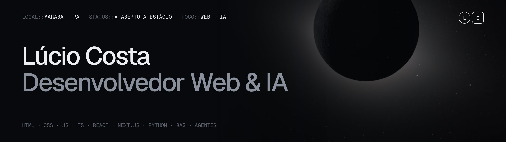

### Olá, eu sou o Lúcio 👋

Desenvolvedor web de Marabá, PA, e estudante de **Sistemas de Informação na UNIFESSPA**.
Construo produtos web com IA, de lojas virtuais a agentes que escolhem ferramentas, buscam e respondem.

Comecei vendendo relógios e acabei construindo a loja inteira: o site, o estoque e um assistente de IA que atende os clientes.
Hoje divido o tempo entre front-end, IA aplicada (RAG e agentes) e sites para negócios locais.

- 🔭 Construindo o **StudyAI**, uma plataforma de estudos com RAG (Next.js, Gemini e pgvector)
- 🌱 Estudando Estruturas de Dados, Algoritmos e o IBM Front-End Developer Certificate
- 🎓 Certificado Google em Suporte Técnico de TI
- 💼 **Aberto a estágio** em TI e desenvolvimento

**[Portfólio](https://luciocosta1302.github.io/Portif-lio-/)** · **[LinkedIn](https://www.linkedin.com/in/luciohrcosta)** · **[luciohrcosta@gmail.com](mailto:luciohrcosta@gmail.com)**

---

### Projetos em destaque

| Projeto | O que é | Stack |
| --- | --- | --- |
| **[lu.ricos](https://github.com/Luciocosta1302/Lu.Ricos)** · [site ↗](https://storeluricos.netlify.app/) | E-commerce de relógios com checkout pelo WhatsApp e o LU.BOT, assistente de vendas com IA | HTML · CSS · JS · LLM |
| **[Atlas AI](https://github.com/Luciocosta1302/atlas-ai-agent)** | Agente que escolhe ferramentas, executa e observa. Memória em SQLite, streaming SSE e 103 testes | Python · LangGraph · FastAPI · Gemini |
| **[Cumaru Interiores](https://github.com/Luciocosta1302/cumaru-interiores)** · [site ↗](https://agent-6a5f7e967b61331e4893f5--cumaru-interioires.netlify.app/) | Landing page com mesa 3D interativa; modelo otimizado de 8,9 MB para 295 KB | Three.js · Python |
| **[Patas Vet](https://github.com/Luciocosta1302/patas-vet)** · [site ↗](https://luciocosta1302.github.io/patas-vet/) | Site para clínica veterinária com agendamento pelo WhatsApp | HTML · CSS · JS |
| **[LivrosEbook](https://github.com/Luciocosta1302/LivrosEbook)** | Agente literário para o Claude Code, com subagente, comandos e bíblia do livro | Prompt engineering · Agents |
| **StudyAI** *(em desenvolvimento)* | Resumos, flashcards, simulados e chat com PDF usando RAG | Next.js · TypeScript · Supabase |

---

### Linguagens e ferramentas

   
   
  

**IA:** Claude · Gemini · ChatGPT · LangChain / LangGraph · RAG · engenharia de prompts
**TI:** hardware e software · redes · sistemas operacionais · troubleshooting · Excel avançado · noções de LGPD

---

Português (nativo) · Inglês (intermediário) · Espanhol (intermediário)
